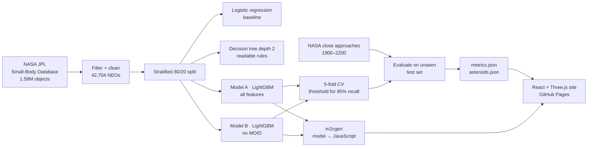

<div align="center">

# ☄️ Is It Coming For Us?

### Teaching a machine to spot hazardous asteroids, and showing every prediction in a live 3D solar system

**Sheridan Datathon 2026 · NASA Track: Beyond Earth · Problem 2: Teach a Machine to See Space**


<!-- Replace with a screenshot or GIF of the 3D view: docs/img/hero.gif -->


</div>

---

## 🔭 The one-minute version

NASA calls an asteroid **potentially hazardous** if its orbit comes within **0.05 AU** of Earth's (MOID) and it's bright enough to be roughly **140 m or bigger** (H ≤ 22). We asked four questions:

| Act | Question | Answer |
|---|---|---|
| **1** | Given every feature, does a model rediscover NASA's rule? | **Yes.** A two-level decision tree writes down `H ≤ 22.035 AND MOID ≤ 0.050`, without being told. |
| **2** | Remove the answer key (MOID). Can it work out the geometry from orbit shape alone? | **Mostly.** It still catches **95.1%** of hazardous asteroids on unseen data (ROC AUC **0.989**). |
| **3** | Did the asteroids it flagged really fly closer to Earth? | **No, and we report it.** Small rocks are only found when they pass close, which skews the flyby record. |
| **4** | Brightness is only a stand-in for size. Are there big, dark asteroids hiding under the cutoff? | **Yes.** **34** near-Earth asteroids were *measured* at ≥ 140 m with orbits inside 0.05 AU, yet aren't labelled hazardous. |

Every one of the **42,704** near-Earth asteroids is drawn on its real orbit, colored by the model's risk score, with **its mistakes highlighted**.

---

## ✨ Features

- 🪐 **Live 3D solar system.** Every near-Earth asteroid on its real orbit (Three.js), with planets, a time slider and click-to-inspect.
- 🔀 **Model toggle.** Switch between Model A (everything) and Model B (no MOID) and watch the colors change.
- 🎯 **Mistakes mode.** Missed hazards and false alarms are highlighted, not hidden.
- 🧪 **Unseen test set filter.** Show only the 8,541 asteroids the models never trained on.
- 🛠️ **Design your own asteroid.** Drag orbit sliders and the trained model scores it **live in your browser** (no server).
- 📊 **Results panel.** Precision, recall, confusion matrix, ROC and PR curves, and the learned rules.
- 🎙️ **Narrated tour.** Pre-generated ElevenLabs voice-over walks judges through the story.

---

## 🧠 How it works



### Data
| Source | Rows | Used for |
|---|---|---|
| [NASA/JPL Small-Body Database](https://ssd.jpl.nasa.gov/tools/sbdb_query.html) | 1,582,869 objects → **42,704 near-Earth asteroids** | Training and testing |
| [NASA/JPL CNEOS close approaches](https://cneos.jpl.nasa.gov/ca/) | 120,071 flybys within 0.1 AU, 1900–2200 | Act 3 check and the flyby timeline (**never a training feature**) |

**Cleaning:** kept `neo == "Y"` only (main-belt asteroids are never hazardous and would make the model look falsely perfect), dropped **346** rows missing the label, H or MOID, kept bound orbits (`e < 1`), and read designations as text so `"170903"` and `"2018 BM3"` join correctly. Result: **2,550 hazardous (6.0%)**.

### Features
| Feature | Meaning | Model A | Model B |
|---|---|:-:|:-:|
| `a`, `e`, `i` | Orbit size, stretch, tilt | ✅ | ✅ |
| `om`, `w` | Orbit orientation (Ω, ω) | ✅ | ✅ |
| `q`, `ad` | Closest and farthest distance from the Sun | ✅ | ✅ |
| `H` | Absolute magnitude (lower = bigger) | ✅ | ✅ |
| `moid` | Closest distance between its orbit and Earth's | ✅ | ❌ *(the answer key)* |

> **Why Model B keeps H:** NASA's rule needs both distance *and* size. Without H, no model can tell a 30 m pebble from a 300 m rock on the same orbit. Keeping H makes Act 2 test exactly what we claim: *can it work out Earth-crossing geometry from orbit shape?*

### Method
- **Stratified 80/20 split** (`random_state=42`). The test set is never used for training or tuning.
- **Class imbalance:** `class_weight="balanced"`, so the models don't simply predict "safe" for everything.
- **Cutoffs chosen for safety:** missing a real threat is worse than a false alarm, so each cutoff is the highest one that keeps **≥ 95% recall in 5-fold cross-validation on the training set**.
- **Honest scores on the map:** each asteroid's color comes from a model that never saw it (out-of-fold scores for training rows, the final model for test rows).

```python
# Pick the decision threshold on training data only, never the test set
def pick_threshold(y, oof_scores, target_recall=0.95):
    prec, rec, thr = precision_recall_curve(y, oof_scores)
    ok = np.where(rec[:-1] >= target_recall)[0]
    return float(thr[ok[-1]]) if len(ok) else 0.5
```

### Models in the browser
Both LightGBM models are compiled to plain JavaScript with **m2cgen**, so the "Design your own asteroid" panel scores orbits instantly, with no backend and no API calls.

```js
import { score } from './model/model_B.js';
// feature order: a, e, i, om, w, q, ad, H
const q = a * (1 - e), ad = a * (1 + e);
const [pSafe, pHazard] = score([a, e, i, om, w, q, ad, H]);   // Apophis → 0.994
```

---

## 📊 Results

**Tested on 8,541 asteroids the models never saw (510 hazardous).** Answering "safe" every time already scores **94.0% accuracy**, so we judge models by **recall** (threats caught) and **precision** (alarms that were real).

| Model | Features | Recall | Precision | ROC AUC | PR AUC |
|---|---|:-:|:-:|:-:|:-:|
| Logistic regression *(baseline)* | all | 97.5% | 55.0% | 0.990 | 0.844 |
| **Model A** · LightGBM | all | **93.5%** | **100%** | **0.9995** | **0.998** |
| **Model B** · LightGBM | no MOID | **95.1%** | 59.1% | 0.989 | 0.859 |

<details>
<summary><b>Confusion matrices</b></summary>

| Model A | Predicted safe | Predicted hazardous |
|---|:-:|:-:|
| **Actually safe** | 8,031 | 0 |
| **Actually hazardous** | 33 | 477 |

| Model B | Predicted safe | Predicted hazardous |
|---|:-:|:-:|
| **Actually safe** | 7,695 | 336 |
| **Actually hazardous** | 25 | 485 |

</details>

### 🔍 What the model learned

**Act 1: it rediscovered NASA's definition.** The depth-2 tree's rules:
```
|--- H <= 22.035
|   |--- moid <= 0.050  →  HAZARDOUS
|   |--- moid >  0.050  →  safe
|--- H >  22.035        →  safe
```
That is NASA's rule (H ≤ 22, MOID ≤ 0.05 AU) recovered almost to the decimal. Model A's top features are **H** and **MOID**, by a wide margin.

**Act 2: without MOID, it leans on size first and orbit shape second.** Model B's top features are **H**, then **q** (perihelion distance), then **ω** and **i**. An orbit can only reach Earth if its closest point to the Sun sits inside about 1 AU, and the model found that on its own.

**Where it fails.** Most of Model B's misses sit right on a boundary, for example **(2000 WC1)** and **(2000 SL10)**, with H just over 22.

**Data-quality finding.** **50** asteroids have an official label that disagrees with NASA's own rule. Their brightness was re-measured near the H = 22 cutoff and the flag never caught up.

### ⭐ Act 4: hidden hazards
A dark asteroid can be big and still look faint, so it slips past the H ≤ 22 brightness cutoff. We trained LightGBM quantile regressors to predict surface reflectivity (albedo) from asteroids whose size *was* measured, then converted brightness to size with the standard formula.

| | Result |
|---|---|
| Size error (median) | **35%** for our model vs 38% for NASA's fixed-albedo formula |
| Known big-but-faint asteroids caught (held-out validation) | **4 of 9**, vs 1 of 9 for the formula |
| **Already measured ≥ 140 m, orbit within 0.05 AU, not labelled hazardous** | **34** |
| Further candidates for follow-up observation | 428 |

Examples: **(2010 LV108)**, measured at 234 m with a MOID of just 0.002 AU, and **(2016 LF2)**, measured at 204 m. Both are bigger than NASA's 140 m threshold, but neither is labelled hazardous because they look faint.

---

## ⚖️ Limitations

- **Act 1 is circular by design.** The label *is* defined by MOID and H, so near-perfect scores there are expected. The interesting result is Act 2.
- **Act 3 did not confirm the model.** Asteroids flagged by Model B were *less* likely to have a recorded pass under 0.05 AU (42% vs 47%). Small asteroids are mostly discovered during close passes, which biases the flyby record, and a pass can never be closer than the orbit's MOID anyway.
- **Scores are risk scores, not probabilities.** Balanced class weights inflate them, so "0.87" means "high risk", not "87% chance".
- **The size range is rough.** Our "5–95%" size range contains the true size 79.5% of the time, not 90%.
- **Catalog bias.** Small, dark and sun-side asteroids are under-counted, and orbits with few observations (condition code 7–9) are uncertain.
- **Orbits change.** Planetary encounters shift orbits over decades. This is a snapshot.

---

## 🚀 Run it locally

**Website**
```bash
git clone https://github.com/abdalla-cooked/DATATHON2026.git
cd DATATHON2026/web
npm install
npm run dev          # open http://localhost:5173
```

**Retrain the models** (needs `data/raw/sbdb.csv` and `data/raw/cad.csv`, shared separately because they're over GitHub's 100 MB limit)
```bash
python -m venv .venv
.venv\Scripts\activate            # macOS/Linux: source .venv/bin/activate
pip install -r requirements.txt
python scripts/train.py           # ~1 min: writes web/public/data/*.json and web/src/model/*.js
```

**Publish to GitHub Pages**
```bash
cd web && npm run build           # writes the static site to docs/
git add docs && git commit -m "Rebuild site" && git push
```

<details>
<summary><b>Windows troubleshooting</b></summary>

- `npm.ps1 cannot be loaded` → run `Set-ExecutionPolicy -Scope CurrentUser RemoteSigned`, or use `npm.cmd`.
- `git` or `node` "not recognized" right after installing → close **all** VS Code windows and reopen.
- `Deletion of directory failed` during `git pull` → pause OneDrive syncing and answer `n`.

</details>

---

## 🗂️ Repo layout

```
DATATHON2026/
├── scripts/
│   └── train.py              # clean → train 4 models + size model → evaluate → export
├── notebooks/train.ipynb     # the same pipeline with plots
├── data/raw/                 # sbdb.csv, cad.csv (gitignored)
├── narration/lines.json      # voice-over script
├── web/                      # website source (React + Vite + Three.js)
│   ├── public/data/          # asteroids.json, metrics.json, approaches.json
│   └── src/
│       ├── model/            # model_A.js, model_B.js (LightGBM → JS via m2cgen)
│       ├── three/            # SolarSystem.jsx, kepler.js, planets.js, time controls
│       └── components/       # TopBar, SidePanel, Legend
└── docs/                     # built site served by GitHub Pages (don't edit by hand)
```

---

## 🛠️ Tech stack

| Layer | Tools |
|---|---|
| Data and ML | Python, pandas, NumPy, scikit-learn, LightGBM, SHAP |
| Model → browser | m2cgen (compiles trained trees to JavaScript) |
| Front end | React 18, Vite 5, Three.js 0.160, Chart.js |
| Voice | ElevenLabs text-to-speech (generated ahead of time, no key in the browser) |
| Hosting | GitHub Pages |

---

## 👥 Team

| Name | Role |
|---|---|
| **Jean-Paul Saliba** | ML lead: data cleaning, models, evaluation, browser export |
| **Alexander Philippopoulos** | 3D lead: Three.js solar system, orbits, time controls, Act 4 size model |
| **Abdalla Shaldam** | Story and UI lead: interface, charts, narration, deployment |

---

## 🙏 Credits

- **NASA/JPL Small-Body Database** and **CNEOS** close-approach data, [ssd.jpl.nasa.gov](https://ssd.jpl.nasa.gov)
- NASA's PHA definition: [cneos.jpl.nasa.gov/about/neo_groups.html](https://cneos.jpl.nasa.gov/about/neo_groups.html)
- Built at the **Sheridan Datathon 2026**, NASA Track: Beyond Earth

<div align="center">

**If this made you look up, give it a ⭐**

</div>
